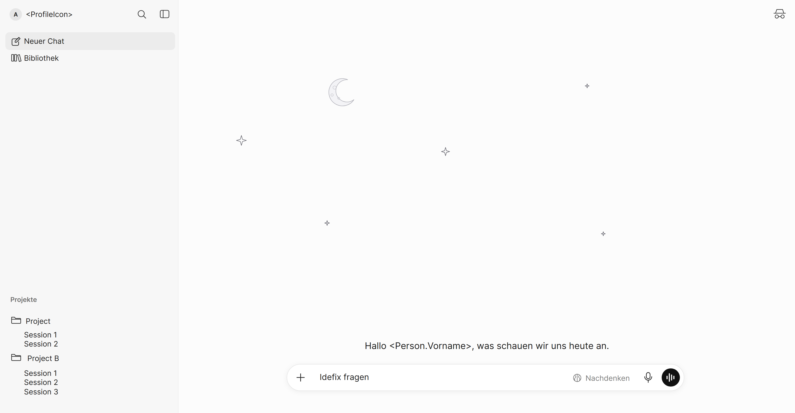

# Idefix

Idefix is a local-first, privacy-focused desktop RAG client. Point it at a folder of PDFs and Word documents, ask questions, and get answers with citations you can click to see the exact highlighted lines in the original.



## Your data stays yours

- Every subfolder of your knowledge folder (default `%USERPROFILE%\IdefixKnowledge`) is a **knowledge plugin**. Add, edit or delete files and Idefix re-indexes in the background.
- Your files are opened read-only and never modified. Idefix splits them into Markdown sections in a visible `_markdown` folder inside each plugin, which you can read and edit.
- Profile and API keys are encrypted with Windows DPAPI; chats are plain JSON in `%LOCALAPPDATA%\Idefix`.
- Works with any OpenAI-compatible chat model, including a local [Ollama](https://ollama.com) or the FHNW Planet Express service. No embedding model is needed.

## Features

- **Sections, no embeddings**: for each question the model first sees a table of contents of all active sections and picks the ones it needs; only those are sent.
- **Ping-pong** ("Nachdenken"): after reading its first picks, the model may ask for more sections, for up to three rounds. Each round shows up live in the conversation.
- **Markdown stays in sync**: sections follow added, changed and deleted documents automatically; "Markdown neu erstellen" in the Library regenerates them on demand.
- **Citations** like `[Mietrecht.pdf, p. 4]` open an in-app viewer with the cited lines highlighted, plus "Open original file".
- **Projects and sessions** in the sidebar; plugins can be scoped per project and toggled per chat with `+`.
- **Context window**: set the model's context size in the profile (e.g. 524288 for GLM-5.3-Flash). If the active documents don't fit, Idefix says so instead of sending them; switch plugins off for that chat with `+`.
- **English and Swiss German**, light and dark themes, Inter typography.
- A quiet celestial background: a sun halo by day; dim stars, a moon and the occasional shooting star at night.
- Automatic updates via Velopack, with an opt-in for nightly builds.

## Building

Requirements: Windows 10 19041+ (Windows 11 recommended) and the .NET 11 SDK (`global.json` pins `11.0.100`).

```powershell
dotnet build Idefix.slnx
dotnet test --solution Idefix.slnx
dotnet run --project src/Idefix.App
```

Set `IDEFIX_DATA_DIR` to keep a development profile separate from your real one:

```powershell
$env:IDEFIX_DATA_DIR = "$env:TEMP\idefix-dev"; dotnet run --project src/Idefix.App
```

## Repository layout

| Path | Purpose |
| --- | --- |
| `src/Idefix.Core` | Domain records, interfaces and pure logic (document context, citation lines, plugin scopes, sky math, mascot) |
| `src/Idefix.Infrastructure` | PdfPig/OpenXml parsing, cached document library, Semantic Kernel answer engine, DPAPI settings, Velopack |
| `src/Idefix.App` | Uno Platform app (Windows App SDK head) |
| `tests/Idefix.ApiTests` | API-level tests with real files and a real index |
| `openspec/` | Project conventions and capability specs |
| `.github/workflows/` | CI, nightly pre-releases, SemVer releases |

## Releases

`<Version>` in `Directory.Build.props` is the single source of truth.

- **Merge into `main`** → the Release workflow publishes `v<Version>` if that tag does not exist yet. Pull requests into `main` fail when `<Version>` is already released.
- **`develop`** → a nightly pre-release `v<Version>-nightly.<run>` when `develop` changed in the last 24 hours.
- **After a release**, bump `<Version>` on `develop` to the next version; nightlies refuse to build an already released version because updaters would ignore them.
- Set the `SIGNING_CERTIFICATE` (base64 PFX) and `SIGNING_PASSWORD` secrets to sign binaries.

## Contributing

Read [`openspec/project.md`](openspec/project.md) first. Analyzers run at `latest-all` with warnings as errors, so build locally before opening a pull request against `develop`.
